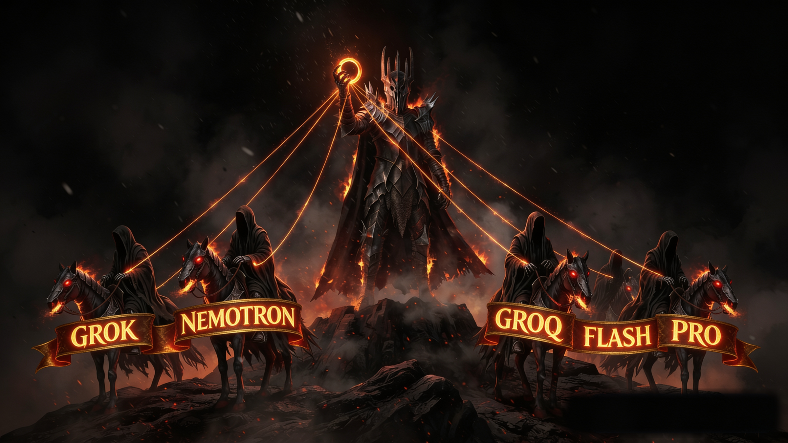

# SAURON v2.0: Multi-Model AI Orchestrator & OpenCode TUI Engine

> **One agent to route them all** — offensive-security AI orchestrator framework rebuilt natively in TypeScript on Bun with OpenCode Terminal UI integration and autonomous cognitive reasoning.



---

## Key Highlights & Architecture Rebuild

- **Zero-Python Production Engine**: Sauron has been completely rebuilt in **TypeScript** running natively on the **Bun v1.4+** runtime. No Python virtual environments or runtime dependencies are required for production CLI execution.
- **OpenCode Terminal UI (TUI)**: Polished, interactive terminal UI with multi-line prompt editing, streaming assistant responses, model picker, tool execution indicators, and history recall.
- **Resilient Prompt Panel & ErrorBoundary**: Built-in ErrorBoundary and isolated input state container ensure that network errors, HTTP 404s, or streaming exceptions **never** collapse or hide the prompt panel.
- **Defensive Sandboxing & ANSI Injection Defense**: Native `stripAnsi()` neutralizes OSC 52 clipboard hijacking, alt-screen toggles, and terminal control sequence injection in untrusted tool stdout.
- **Cognitive ReAct Agent**: Autonomous reasoning loop with sequential multi-tool execution (capped at 4 per turn), explicit exit code propagation, structured JSON syntax feedback, and loop stagnation halts.
- **Dynamic DAG Planning & Finding Propagation**: Goals decompose into Recon $\rightarrow$ Inspect $\rightarrow$ Verify DAG structures with topological scheduling and stdout finding propagation (`uid`, `user`, `ip`, `arch`, `os`).
- **Autonomous Playbook Distillation**: Execution traces are distilled into reusable, parameterized tactics (`{{target_host}}`, `{{user_name}}`) with semantic keyword recall and rolling success stats.
- **Self-Healing Tool Resolution**: Automatic capability mapping and command mutation upon exit code 127 / "command not found" (`ps aux` $\rightarrow$ `ps -ef`, `ip addr` $\rightarrow$ `ifconfig -a`), persisting learned resolutions to `~/.sauron/resolutions.json`.
- **Adaptive Mission Pipeline**: 3-stage Writer $\rightarrow$ Executor $\rightarrow$ Judge pipeline with hardened 30/40/30 scoring rubric (Exit status 30, Relevance 40, Completeness 30; PASS threshold $\ge 75$).
- **Multi-Provider Catalog & Closed-Loop Learning**: Dynamic catalog across Anthropic, OpenAI, Gemini, OpenRouter, Cohere, xAI, and Azure with error classification taxonomy (`rate_limit`, `transient`, `persistent`, `request`), exponential backoff cooldowns, and closed-loop routing bias.
- **Antigravity Provider (keyless)**: `antigravity` shells out to the already-authenticated `agy` CLI (`agy -p <prompt> --output-format text --model <id>`) — no API key. Gemini/GPT-OSS ids are auto-routable; `claude-sonnet-4-6` and `claude-opus-4-6-thinking` are explicit-selection only and never auto-routed.

---

## Prerequisites & Installation

### Requirements
- **Linux (Kali Linux recommended)** or macOS.
- **Bun**: v1.4.0 or higher (`~/.bun/bin/bun` or system `bun`).
- **Node.js**: v18+ (for binary launcher delegation).

### Quick Start
```bash
# Clone the repository
git clone https://github.com/crowx01/sauron.git
cd sauron

# Install Bun if not already installed
curl -fsSL https://bun.sh/install | bash

# Install dependencies
bun install

# Start the interactive OpenCode TUI
sauron chat
# or
node bin/cli.js chat
```

---

## Usage Commands

| Command | Description |
| :--- | :--- |
| `sauron chat` | Launch the interactive OpenCode terminal UI |
| `sauron run "<task>"` | Execute a headless one-shot task |
| `sauron mission "<goal>"` | Run the adaptive 3-phase Writer -> Executor -> Judge pipeline |
| `sauron diag` | Print system diagnostics, Bun version, toolbelt status, and catalog entries |
| `sauron models` | Display intelligence catalog rankings and model availability |
| `sauron sessions` | List saved conversation sessions in `~/.sauron/sessions/` |
| `sauron debate "<q>"` | Run a multi-model architectural review debate |
| `sauron selftest` | Run self-diagnostic checks across runtime components |

---

## Key Project Deliverables & Architecture Documentation

- [`architecture-decision.md`](architecture-decision.md): ADR-001 detailing technology evaluation, candidate comparisons, service boundaries, and design choices.
- [`claude-debate.md`](claude-debate.md): Full transcript of all 8 rounds of architectural debates conducted with local Claude Code CLI (`claude` v2.1.296).
- [`migration-plan.md`](migration-plan.md): Phased migration plan (Phases 0 through 5).
- [`error-audit.md`](error-audit.md): Root-cause analysis and reproduction notes for terminal prompt disappearance bugs.
- [`pending-changes.md`](pending-changes.md): Inventory log of migrated, added, and retired repository files.

---

## Testing & Quality Assurance

Sauron features a comprehensive native Bun test suite:

```bash
# Run all 83 automated tests across 7 test suites
bun test

# Target a specific suite
bun test tests/agentic_logic.test.ts
bun test tests/intelligence_and_dag.test.ts
bun test tests/adversarial.test.ts
```

### Test Suite Summary
| Test Suite | Tests | Description |
| :--- | :---: | :--- |
| `tests/adversarial.test.ts` | 39 | 50 concurrent streams, process group kills, 1MB flood cap, SSRF, fuzzing |
| `tests/agentic_logic.test.ts` | 9 | ReAct loops, injection defense, 30/40/30 rubric, rate-limit cooldowns, ANSI stripping |
| `tests/intelligence_and_dag.test.ts` | 8 | Playbook distillation, ToolResolver mutation, DAG planning, finding propagation |
| `tests/e2e_cli.test.ts` | 7 | CLI subcommands (`diag`, `models`, `sessions`, `mission`, `run`, `debate`, `selftest`) |
| `tests/scenarios.test.ts` | 8 | Streaming, fact memory, tool execution, model switching, fallback, layout |
| `tests/stress_and_lifecycle.test.ts` | 7 | Corrupt session quarantines, path traversal, 1MB output cap, SSRF guards |
| `tests/engine.test.ts` | 5 | Core ChatRouter, ToolBelt, SessionStore, MissionRunner, and streaming |
| **Total** | **83** | **100% Pass Rate (0 failures, 2760 assertions)** |

---

## License
MIT License. See [LICENSE](LICENSE) for details.

